# Activity 7 – CI/CD Pipeline with Jenkins, Docker and Kubernetes

Jenkins job: **`Healthcare-CI-CD`** · Jenkinsfile: [`Jenkinsfile`](../Jenkinsfile)

## 1. Objective

Build, test, publish and deploy the Healthcare Appointment Management
application automatically on every release: from GitHub, through Docker
and Docker Hub, to a K3s Kubernetes cluster on AWS EC2, with genuine
verification at every step.

## 2. Pipeline

```mermaid
flowchart LR
    A[Checkout<br/>verify latest main] --> B[Validate Source<br/>files + secret hygiene]
    B --> C[Run Application Tests<br/>pytest in Docker]
    C --> D[Build Docker Image<br/>build-sha tag]
    D --> E[Validate Docker Image<br/>UID, port, HEALTHCHECK, /health, /version]
    E --> F[Docker Hub: login, push,<br/>verify registry digest, move latest]
    F --> G[Verify EC2 SSH<br/>key ACL, pinned host key, IMDS identity, lock]
    G --> H[Deploy to Kubernetes<br/>capacity check, apply]
    H --> I[Verify Rollout<br/>pods, probes, version, endpoints]
    I --> J[Smoke Tests<br/>9 HTTP checks]
    J --> K[post: release lock, cleanup]
```



| Stage | What is verified (failure stops the build) |
|---|---|
| Checkout | Commit SHA is valid and equals `origin/main` |
| Validate Source | Required files exist; no `.pem`/`.key`/kubeconfig tracked; no private-key text in Git |
| Run Application Tests | `docker build --target test` then pytest; JUnit published |
| Build Docker Image | Tag `<build>-<sha7>`, `APP_VERSION` baked in, OCI labels |
| Validate Docker Image | User 10001, exposes 5000/tcp, HEALTHCHECK present and becomes `healthy`, `/health` 200, `/version` = tag, `id -u` = 10001 |
| Docker Hub | Login through an isolated, SYSTEM-only `DOCKER_CONFIG`; push; digest reported by the registry API equals the pushed digest; `latest` moved only after that |
| Verify EC2 SSH | Key ACL restricted to SYSTEM and verified; host key fingerprint pinned (`StrictHostKeyChecking=yes`); real authentication; instance ID and private IP confirmed via IMDSv2; namespace deploy lock acquired |
| Deploy | Node Ready; capacity check; server-side dry run; apply; change-cause annotation |
| Verify Rollout | `rollout status` (240 s bound); spec image; ready/updated/available = 2; old pods gone; 50 s stability window with 0 restarts; per-pod `/version`; EndpointSlice IPs = pod IPs |
| Smoke Tests | Via `healthcare-rolling-service` on the node: `/health`, `/`, `/version` ×10, `/api/doctors`, invalid POSTs → 400, unknown doctor → 404, valid synthetic POST → 201 |
| Cleanup (`post`) | Lock released (stage `post`); containers, build-specific image tags, temp directory removed; no credential files may remain |

## 3. Key implementation details

### Windows private-key ACL (root cause of the original failures)

Jenkins (running as `LocalSystem`) writes the temporary SSH key under the
workspace `@tmp` folder, which inherits `BUILTIN\Users:(RX)`. Windows OpenSSH
refuses such keys (`UNPROTECTED PRIVATE KEY FILE`). The earlier fix granted
`$env:USERNAME` – for LocalSystem that is the machine account, not SYSTEM –
and hid the `icacls` output. `Protect-PrivatePath` (in `ci/lib.ps1`) now:

1. `icacls <key> /inheritance:r` – removes inherited ACEs;
2. `icacls <key> /grant:r *S-1-5-18:(F)` – SYSTEM only (plus the current user when not SYSTEM);
3. removes every other explicit ACE, fixes the owner if needed;
4. verifies with `Get-Acl` that inheritance is off and only allowed SIDs remain.

### PowerShell native-command handling

`Invoke-Native` converts stderr to text and judges success only by the exit
code. It resets `$LASTEXITCODE` because the Jenkins PowerShell wrapper ends
with `exit $LASTEXITCODE` (an expected non-zero code, such as `git grep`
finding nothing, otherwise failed the stage). When piping input it uses
BOM-less UTF-8, because the wrapper's UTF-8 console encoding prefixed the
Docker Hub token with a byte-order mark.

### Remote execution

Scripts are copied to a `mktemp` directory on the node and run **detached**
(`ci/remote/job.sh`). Jenkins polls them over short SSH calls: a dropped
connection can neither kill an operation half-way nor lose its output
(bounded: 5 s interval, 6 consecutive failed polls, overall timeout).

### Coexistence with Activity 8

This job owns the `rolling` environment (`healthcare-deployment` with
`environment=rolling`, and `healthcare-rolling-service`, NodePort 30061). The
production Service belongs to Activity 8. Because Deployment selectors are
immutable, `deploy.sh` recreated the old app-only Deployment once (build #7,
logged as `MIGRATION`).

## 4. Commands used (examples)

```powershell
# Trigger a build (API token read from a local file inside the script; never on the command line)
Invoke-WebRequest -Method Post -Uri http://localhost:8080/job/Healthcare-CI-CD/build -Headers $authHeader
```
```bash
docker build --target test -t healthcare-app-test:<tag> .     # test image
docker run --network none healthcare-app-test:<tag>             # pytest
docker build --target runtime --build-arg APP_VERSION=<tag> -t niranjanbalaguru/healthcare-app:<tag> .
docker image inspect niranjanbalaguru/healthcare-app:<tag>      # user, ports, healthcheck
sudo kubectl -n healthcare rollout status deployment/healthcare-deployment --timeout=240s
sudo kubectl -n healthcare get deployments,pods,services,endpointslices -o wide
curl -s http://127.0.0.1:30061/version                          # on the EC2 node
```

## 5. Verified results

| Build | Commit | Image | Result | Evidence |
|---|---|---|---|---|
| #6 | `eeed966` | `6-eeed966` | SUCCESS | First fully green run: 32 tests, 2/2 pods, 9/9 smoke tests |
| #7 | `5d27aeb` | `7-5d27aeb` | SUCCESS | Selector migration to `environment=rolling`, deploy lock, 42 tests, 9/9 smoke tests |
| #8 | `c02986f` | `8-c02986f` | SUCCESS | Hardened pods (read-only root FS, seccomp) – 56 tests, 2/2 Ready, 0 restarts, 9/9 smoke tests |

Builds #1–#5 failed while the original pipeline problems were diagnosed
(exit-code leakage, then the Docker Hub token/BOM issue); the root causes
are documented in the consolidated report.
