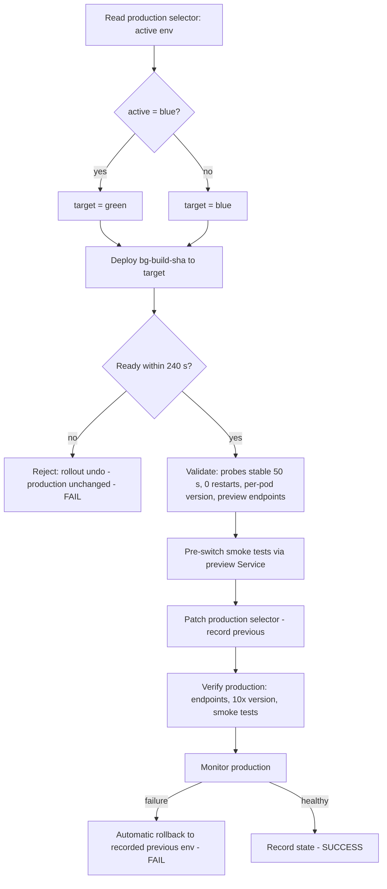

# Activity 8 – Automated Blue-Green Deployment

Jenkins job: **`Healthcare-Blue-Green`** · Jenkinsfile:
[`pipelines/blue-green.Jenkinsfile`](../pipelines/blue-green.Jenkinsfile) ·
Remote logic: [`ci/remote/bluegreen.sh`](../ci/remote/bluegreen.sh)

## 1. Objective and theory

Blue-Green deployment keeps two complete production-capable environments.
One (say **blue**) serves users; the new version is deployed to the other
(**green**), tested there while users are unaffected, and then traffic is
switched in a single step. The old environment keeps running, so rollback is
just switching back – no rebuild, no redeploy. Benefits: near-zero downtime,
full testing of the exact release before it receives traffic, and an
instant, low-risk rollback path. The cost is running two environments at
once, so capacity has to be planned.

## 2. Kubernetes design

| Object | Labels / selector | Role |
|---|---|---|
| `healthcare-blue` | `app=healthcare, environment=blue` | Environment A (2 replicas) |
| `healthcare-green` | `app=healthcare, environment=green` | Environment B (2 replicas) |
| `healthcare-service` (NodePort 30060) | selector `app=healthcare, environment=<active>` | **Production** traffic |
| `healthcare-preview-service` (ClusterIP) | selector `app=healthcare, environment=<candidate>` | Pre-switch testing (internal only) |

* The production selector is the **source of truth** for which environment
  is live; the pipeline never assumes blue is production. Service
  annotations (`healthcare.pbl/active-*`, `previous-*`, `last-operation`,
  `last-build`, `last-commit`, `rollback-reason`) record the history needed
  for rollback.
* The production Service manifest is only applied when the Service does not
  exist; afterwards its selector changes only through the validated
  `switch` / `rollback` operations.
* Both Deployments have identical, hardened pod specs (tests enforce this).
* Adoption of the pre-existing Service: before the first release the
  Service selected `app=healthcare` only. The pipeline pinned it to
  `environment=rolling` (the same Activity 7 pods – no traffic change) so a
  candidate could never receive traffic before validation.

## 3. Pipeline

| Stage | Purpose |
|---|---|
| Checkout, Source Validation, Application Tests | As Activity 7 (71 tests) |
| Build / Validate / Publish image | Immutable tag `bg-<build>-<sha7>`; registry digest verified; `latest` is not used |
| Determine Current Production Environment | Verify EC2 identity, take deploy lock, read the live selector, choose the inactive target, capacity check |
| Prepare / Deploy Inactive Environment | Render the exact image into the target's manifest; server-side dry run; apply; point preview Service at the target |
| Wait for Readiness | `rollout status` (240 s). On failure the candidate is **rejected**: `rollout undo` (or scale to 0) and production stays unchanged |
| Validate Inactive Environment | 50 s probe-stability window, 0 restarts, image check, per-pod `/version`, preview endpoints; production selector must not have changed |
| Run Pre-Switch Smoke Tests | 9 HTTP checks through the preview Service |
| Switch Production Service | Patch selector; record previous environment/image/version; verify endpoints = target pods; 10 production requests return the new version; previous environment still Ready |
| Verify Production Traffic | 9 smoke tests through the production Service |
| Monitor New Production Version | Health/version/pod checks every 10 s for `MONITOR_SECONDS` |
| Manual Rollback (`ACTION=rollback`) | Switch back only if the previous environment still runs the **recorded, verified** image and all pods are Ready |
| Record Deployment State | JSON + text state archived as build artifacts |
| Stage `post` | `failure` after a switch → **automatic rollback**; `cleanup` → release lock |

## 4. Resource management

Node: 2 vCPU, 1909 Mi allocatable. Each pod requests 50m CPU / 64 Mi
(limits 300m / 256 Mi). Measured before the first blue-green release:
450m CPU / 460 Mi requested by all pods (including unrelated workloads);
with 6 application pods (rolling + blue + green): 650m CPU (32 %) / 716 Mi
(37 %) requested; actual node memory use 1394 Mi (73 %). A rollout adds one
surge pod. `capacity_check` compares allocatable resources with the
requests of every running pod plus the rollout's needs **before** any
deployment and fails with the exact shortfall if capacity is insufficient.
Limits are overcommitted (memory limits 112 %), which Kubernetes allows; it
is listed as an operational risk. Replicas are configurable (`REPLICAS`,
1–4); all runs used 2.

## 5. Verified results

| Build | Action | Before → after | Result | What it proves |
|---|---|---|---|---|
| #1 | deploy | rolling (`7-5d27aeb`) → **blue** (`bg-1-5d27aeb`) | SUCCESS | Adoption of legacy production, first validated switch |
| #2 | deploy | blue → **green** (`bg-2-5d27aeb`) | SUCCESS | **Blue-to-Green promotion**; both versions running simultaneously |
| #3 | deploy + `SIMULATE_FAILED_VALIDATION` | green stays | FAILURE (expected) | Candidate rejected; SSH session reset hid the remote log → corrective change 1 |
| #4 | rollback | green → **blue** (`bg-1-5d27aeb`) | SUCCESS | **Green-to-Blue rollback** to the recorded, verified image |
| #5 | deploy + `SIMULATE_FAILED_VALIDATION` | blue stays | FAILURE (expected) | **Failed validation prevents promotion**: readiness 404, rollout timed out, candidate undone, production unchanged |
| #6 | deploy | blue stays | FAILURE | SSH transport failure before the readiness wait → corrective change 2 |
| #7 | deploy + `SIMULATE_POST_SWITCH_FAILURE` | blue → green → **blue** | FAILURE (expected) | **Automatic rollback** after a failed post-switch check |
| #8 | deploy | blue → **green** (`bg-8-ae90509`) | SUCCESS | Final, hardened release; production healthy |

Corrective iterations: 2 (`59c906c` detached remote execution; `ae90509`
retry of SSH transport failures with an idempotent job start).

Final state (verified independently over SSH): production
`healthcare-service` → **green**, `bg-8-ae90509`, 2/2 Ready, 0 restarts;
blue kept on `bg-1-5d27aeb` (2/2) as the rollback target; Activity 7
rolling environment on `9-0d720d8` (2/2).

## 6. Challenges

1. **Selector overlap with Activity 7** – the original Deployment and
   Service selected `app=healthcare` only, which would have routed
   production traffic to unvalidated candidate pods. Fixed with an
   `environment` label, a dedicated rolling Service and a guarded one-time
   Deployment recreation (selectors are immutable).
2. **Lost SSH sessions** – build #3's 5-minute rollout wait ran inside one
   SSH session, which was reset (exit 255). The remote logic completed, but
   its output was lost, and a reset during a switch could SIGHUP the script.
   A 5.5-minute idle session did not reproduce it, so it is treated as
   transient network loss. Remote operations now run detached on the node
   (`ci/remote/job.sh`) and are polled.
3. **SSH failures outside polling** – build #6 failed when the call that
   *starts* the detached job hit a transport failure. `job.sh start` became
   idempotent, and transport failures (exit 255 only) are retried at most 3
   times.

## 7. Limitations

* In-memory appointments are per process, so they are not shared between
  replicas or environments; there is no database migration to coordinate.
* The `rollback-reason` annotation from build #7 still exists after the
  later promotion (#8), because the switch operation does not clear it. The
  value is historical, not current.
* Single-node cluster: blue and green share one node, so this protects
  against bad releases, not node failure.
