# Activity 9 – Secure DevOps (DevSecOps)

Jenkins job: **`Healthcare-DevSecOps`** · Jenkinsfile:
[`pipelines/devsecops.Jenkinsfile`](../pipelines/devsecops.Jenkinsfile) ·
Policy: [`docs/security-policy.md`](security-policy.md)

> Academic demonstration with synthetic data only – not production healthcare
> software, and no regulatory compliance is claimed.

## 1. Objective and principles

Integrate security into the delivery pipeline ("shift left") so that every
build is checked for leaked secrets, insecure code, vulnerable dependencies,
insecure container and Kubernetes configuration, and runtime web weaknesses,
and so that a **policy gate** – not a person's impression – decides whether
the image may be released. Principles applied: automate every check, fail
closed (a broken scanner fails the build), keep evidence (reports and SBOM
archived per build), least privilege, and documented, expiring exceptions
instead of silent suppressions.

## 2. Pipeline

```mermaid
flowchart LR
    C[Checkout + tools<br/>pinned scanner images,<br/>clean git archive] --> S[Secret Detection<br/>Gitleaks + self-test]
    S --> A[SAST<br/>Semgrep]
    A --> D[Dependencies<br/>pip-audit]
    D --> T[Application Tests<br/>71 tests]
    T --> DF[Dockerfile scan<br/>Trivy config]
    DF --> B[Image build + validation]
    B --> V[Container scan<br/>Trivy image]
    V --> SB[SBOM<br/>CycloneDX]
    SB --> K[K8s manifest scan<br/>Trivy config]
    K --> Z[DAST<br/>ZAP baseline + API scan]
    Z --> G{Security gate}
    G -->|PASS| AR[Archive reports] --> P[Publish verified image<br/>sec-build-sha]
    G -->|FAIL / TOOL-ERROR| X[Build fails]
```

## 3. Tools (all pinned, all actually executed)

| Area | Tool | Installation | Command (inside the container) | Scans |
|---|---|---|---|---|
| Secrets | Gitleaks v8.30.1 | `ghcr.io/gitleaks/gitleaks:v8.30.1` | `gitleaks git /repo --redact --report-format json --exit-code 3` | Every commit in the repository history |
| Secret self-test | Gitleaks v8.30.1 | same | `gitleaks dir /scan ...` on a fixture containing a random synthetic AWS key generated at runtime | Proves the detector works; fixture deleted afterwards |
| SAST | Semgrep 1.182.1 | `ci/security/tools.Dockerfile` (pip, pinned) | `semgrep scan --config p/python --config p/flask --config p/dockerfile --config p/secrets --config p/security-audit --metrics=off --json /src` | Python/Flask code, Dockerfile, secrets |
| Dependencies | pip-audit 2.10.1 | tools image | `pip-audit -r app/requirements.txt -r requirements-dev.txt --format json --desc on` | Direct + transitive Python packages (13) |
| Dockerfile | Trivy 0.76.1 | `ghcr.io/aquasecurity/trivy:0.76.1` | `trivy config` | Dockerfile misconfiguration |
| Container image | Trivy 0.76.1 | same (DB cached in a named volume) | `trivy image --input image.tar --scanners vuln,secret` | OS packages, Python packages, embedded secrets of the **exact immutable tag** |
| SBOM | Trivy 0.76.1 | same | `trivy image --input image.tar --format cyclonedx` | Bill of materials of the exact image |
| Kubernetes | Trivy 0.76.1 | same | `trivy config /scan` (k8s/) | Privileges, root, capabilities, host access, probes, resources, seccomp, read-only FS |
| DAST | OWASP ZAP 2.16.1 | `ghcr.io/zaproxy/zaproxy:2.16.1` | `zap-baseline.py` (passive) and `zap-api-scan.py -f openapi` (active, against `ci/security/openapi.yaml`) | All HTTP endpoints of a **disposable** read-only container on an `--internal` Docker network – never the live deployment |
| Gate | `evaluate_policy.py` | tools image (PyYAML 6.0.2) | `python evaluate_policy.py <reports> security-policy.yaml ...` | Applies the policy to all reports |

Why these tools: they are open source, run as containers on the Windows
Jenkins agent (Docker Desktop), cover every requested area, and their
images come from GHCR (Docker Hub pulls are affected by a stale Docker
Desktop session on this laptop). Checkov was not added because Trivy
already covers Dockerfile and Kubernetes configuration. Cosign image
signing was **not implemented** (see limitations).

Engineering notes:

* Inputs and outputs move with `docker cp`, not bind mounts, so the
  SYSTEM-only ACLs on the build's temp directory never need to be relaxed
  for Docker Desktop's file sharing.
* Scanners read a clean `git archive` of the exact commit, not the workspace.
* Every scanner's exit code is recorded; a code that means "tool failure"
  stops the stage immediately and is a `TOOL-ERROR` in the gate.

## 4. Findings and remediation

Initial (pre-remediation) scan results and what was done – details in
[security-policy.md §4](security-policy.md):

| Control | Initial findings | Action | After |
|---|---|---|---|
| Semgrep | 1 ERROR (`missing-user`, Dockerfile test stage), 1 WARNING (`avoid_app_run_with_bad_host`) | Both fixed | 0 findings |
| pip-audit | Flask 3.1.2 CVE-2026-27205; pytest 8.3.5 CVE-2025-71176 | Upgraded (Flask 3.1.3, pytest 9.0.3); full test suite re-run | 0 vulnerabilities |
| Trivy image | 0 CRITICAL, 51 HIGH, 90 MEDIUM, 65 LOW, 5 UNKNOWN (OS) + 7 Python MEDIUM/LOW | `apt-get upgrade` removed every fixable HIGH | 0 CRITICAL, 47 HIGH (no fix available – 11 CVEs, approved exceptions), 94 MEDIUM, 66 LOW, 5 UNKNOWN |
| Trivy K8s | 2 HIGH (KSV-0014, KSV-0118), 2 MEDIUM, 2 LOW per Deployment | Read-only root FS, pod securityContext, seccomp, GID, no SA token | 3 × MEDIUM KSV-0125 (registry allow-list; tracked) |
| Trivy Dockerfile | 0 | – | 0 |
| ZAP | 10021, 10038 (missing headers), 100001 (HTML error pages) | Security headers, JSON error handlers | Baseline 0 alerts; API scan 1 Informational (expected 4xx) |
| Gitleaks | 0 leaks in full history; synthetic secret detected | – | unchanged |

Every finding was assessed: the Semgrep, pip-audit, Trivy KSV and ZAP
findings were true positives and were fixed; the 47 unfixable HIGH OS-package
findings are true positives that are **not reachable** in this application
and are accepted only under explicit, expiring exceptions.

## 5. Verified Jenkins results

**Build #1** (commit `c02986f`, image `sec-1-c02986f`): **SUCCESS**, 233 s.

| Security control | Tool | Execution | Findings | Gate |
|---|---|---|---|---|
| SAST | Semgrep | Executed (32 files) | 0 | PASS |
| Secret detection | Gitleaks | Executed (full history) + self-test detected synthetic AWS key | 0 | PASS |
| Dependency scanning | pip-audit | Executed (13 packages) | 0 | PASS |
| Container scanning | Trivy | Executed on `sec-1-c02986f` | CRITICAL 0, HIGH 47, MEDIUM 94, LOW 66, UNKNOWN 5 | PASS-WITH-EXCEPTIONS (47 excepted, 0 blocking) |
| Dockerfile scanning | Trivy config | Executed | 0 | PASS |
| Kubernetes scanning | Trivy config | Executed | MEDIUM 3 | WARN |
| DAST | OWASP ZAP | Executed (baseline + API scan) | Informational 1 | WARN |
| SBOM | Trivy CycloneDX 1.7 | Generated, archived | 98 components | PASS |

Overall gate: **PASS**. 27 report files passed the secret check and were
archived. The verified image `niranjanbalaguru/healthcare-app:sec-1-c02986f`
(digest `sha256:71deaadb…a592`) was pushed and its digest confirmed through
the Docker Hub registry API.

Additional evidence that scanner failures are not passes:

* During local pre-validation, a broken source export made Semgrep scan an
  empty directory. This was turned into a guard: the stage and the gate both
  require that `app/app.py` and `Dockerfile` were scanned. The other
  consequences of that failure surfaced as `TOOL-ERROR`, not `PASS`.
* `tests/test_security_policy.py` (15 tests, executed in every pipeline)
  covers crashed tools, missing or malformed reports, empty scans, missing
  SBOMs, and invalid/expired/blanket exceptions.

## 6. Limitations

* 11 HIGH CVEs (47 package findings) in the Debian base remain unresolved
  until Debian publishes fixes; the exceptions expire on 2026-12-31.
* Semgrep registry rulesets (`p/...`) are fetched at scan time, so the rule
  versions are not pinned (the Semgrep engine version is).
* The Trivy vulnerability database updates daily, so counts can change
  between builds for the same image.
* Cosign signing/provenance was not implemented; no signing claim is made.
* NetworkPolicies were not introduced: they would need validation against
  this cluster's CNI and the node-local NodePort test path, which was not
  in scope to change.
* ZAP's active scan targets the API surface described in
  `ci/security/openapi.yaml`; it is not a full penetration test.
