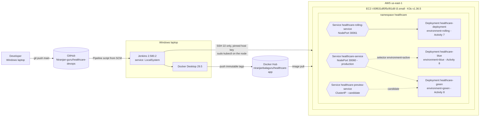
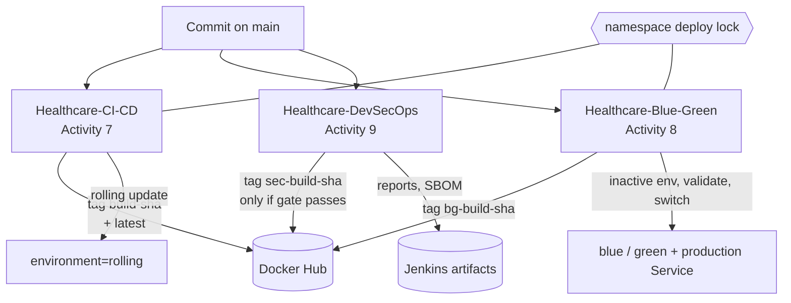

# Architecture

## 1. Overview

* The K3s API (6443) is **not** exposed; all `kubectl` commands run on the
  node through SSH. The security group allows SSH (22) from one /32 only and
  does not expose the NodePorts; all HTTP tests run on the node itself.
* No kubeconfig is ever copied to Windows.

## 2. Components

| Component | Purpose |
|---|---|
| `app/app.py` | Flask API: `/`, `/health`, `/version`, `/api/doctors`, `/api/appointments` (synthetic, in-memory data), security headers, JSON error handlers |
| `Dockerfile` | Multi-stage: `base` (python:3.12-slim + security updates + deps), `test` (pytest, non-root), `runtime` (Gunicorn, UID 10001, HEALTHCHECK, `APP_VERSION` baked in) |
| `k8s/` | Activity 7 rolling Deployment + Service; `k8s/blue-green/` Activity 8 Deployments + production/preview Services |
| `Jenkinsfile` | Activity 7 job `Healthcare-CI-CD` |
| `pipelines/blue-green.Jenkinsfile` | Activity 8 job `Healthcare-Blue-Green` |
| `pipelines/devsecops.Jenkinsfile` | Activity 9 job `Healthcare-DevSecOps` |
| `ci/lib.ps1` | Native-command handling, Windows ACL hardening, pinned SSH, detached remote execution, bundle rendering, Docker Hub registry API |
| `ci/stages.ps1` | Stage implementations shared by all three jobs |
| `ci/security.ps1` | Activity 9 scanner stages |
| `ci/remote/*.sh` | EC2-side scripts: host verification, rolling deploy, blue-green operations, namespace lock, smoke tests, detached job runner, shared Kubernetes checks |
| `ci/security/` | Security policy, gate evaluator, pinned tools image, OpenAPI description for DAST |

## 3. Kubernetes objects in namespace `healthcare`

| Object | Owner | Selector / labels | Exposure |
|---|---|---|---|
| `healthcare-deployment` | Activity 7 | `app=healthcare, environment=rolling` | via `healthcare-rolling-service` |
| `healthcare-rolling-service` | Activity 7 | `environment=rolling` | NodePort 30061 (node-local tests) |
| `healthcare-blue` / `healthcare-green` | Activity 8 | `environment=blue` / `green` | via the Services below |
| `healthcare-service` | Activity 8 | `app=healthcare, environment=<active>` | **Production**, NodePort 30060 |
| `healthcare-preview-service` | Activity 8 | `environment=<candidate>` | ClusterIP only |
| `healthcare-deploy-lock` (ConfigMap, transient) | Activities 7 and 8 | – | Serialises deployments |

All three Deployments share an identical pod specification (verified by
tests): 2 replicas, RollingUpdate (maxSurge 1, maxUnavailable 0), readiness
and liveness probes on `/health`, requests 50m CPU / 64Mi, limits 300m /
256Mi, pod and container `securityContext` (UID/GID 10001, non-root,
`allowPrivilegeEscalation: false`, all capabilities dropped,
`readOnlyRootFilesystem: true`, seccomp `RuntimeDefault`), memory-backed
`/tmp`, and `automountServiceAccountToken: false`.

## 4. How the three pipelines relate

* The jobs are independent and have no triggers between them, so there are
  no circular or recursive builds. Each has `disableConcurrentBuilds()`.
* Activities 7 and 8 both deploy into `healthcare`, so they share a
  ConfigMap-based lock (Jenkins has no Lockable Resources plugin): creation is
  atomic, the holder is recorded, stale locks expire after 45 min and waiting
  is bounded to 5 min.
* Image tags carry a pipeline prefix because each job has its own build
  counter; without it, two jobs could produce the same tag for different
  images.

## 5. Traceability

| From | To | How |
|---|---|---|
| Git commit | Jenkins build | Checkout verifies the commit equals `origin/main`; build display name contains the short SHA |
| Jenkins build | Docker image | Tag `<prefix><build>-<sha7>`; OCI labels `revision`, `version`, `source` |
| Docker image | Docker Hub | Pushed digest compared with the registry-reported digest |
| Docker image | Application | `APP_VERSION` = image tag, reported by `/version` and verified per pod |
| Image | Kubernetes | Deployment image verified equal to the build image; `kubernetes.io/change-cause` annotation |
| Production state | Service annotations | `healthcare.pbl/active-*`, `previous-*`, `last-operation`, `last-build`, `last-commit`, `rollback-reason` |
| Image | SBOM and scan reports | `sbom-<tag>.cdx.json` and `sbom-metadata.json` (commit, build, image ID) archived with the build |
